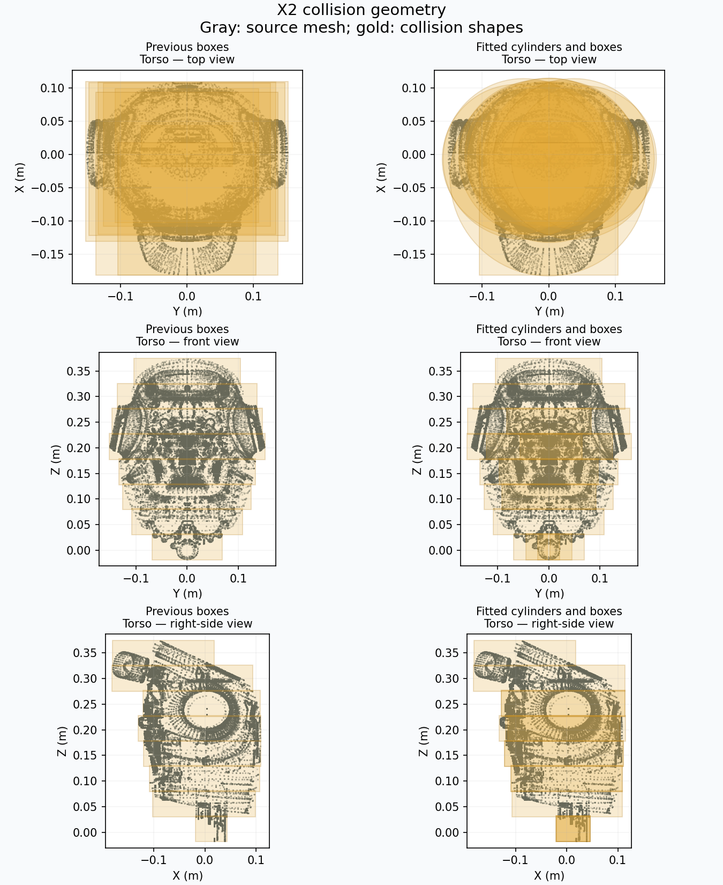
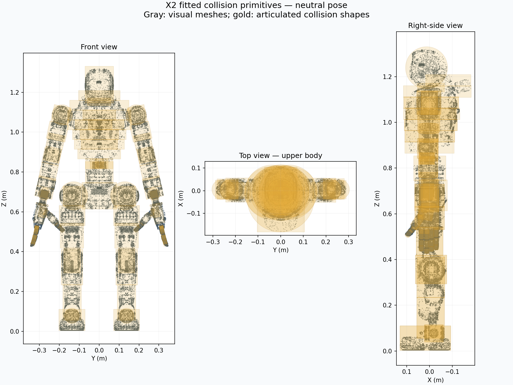
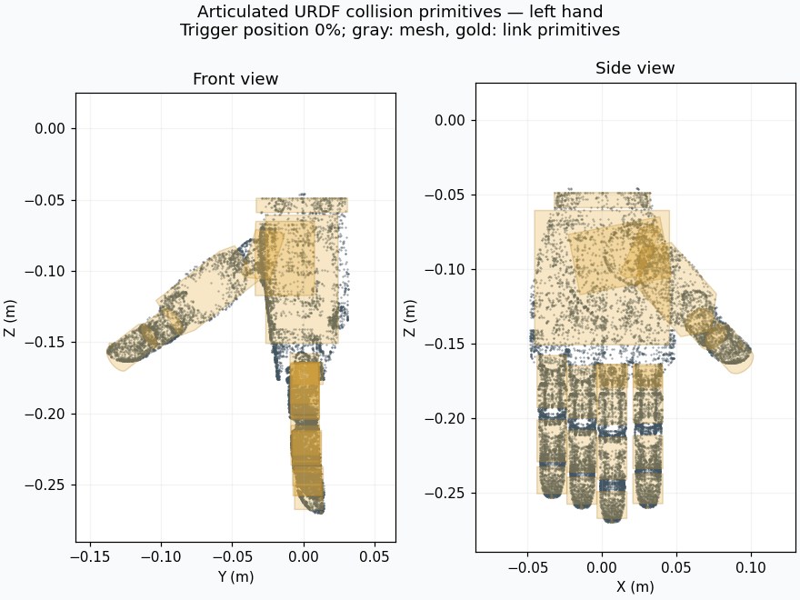

# Agibot X2 arm simulation assets

Source: [Agibot X2 URDF repository](https://github.com/AgibotTech/agibot_x2_urdf),
commit `575cc6b988f976c23550e0db85aa1e5475d3652d`, directory `X2_URDF-v1.3.0`,
supplied from `/home/ubuntu/agibot_x2_urdf`. The upstream models and meshes are licensed under
Mulan PSL v2; see [LICENSE](LICENSE). This license applies to these model assets,
independently of the surrounding project's MIT license.

`x2_ultra.urdf` is the unmodified source URDF. `meshes/` contains all 39 meshes
referenced by the source URDF and the adapted MuJoCo model.

Modifications for this demo:

- `x2_fixed.urdf` fixes legs, waist, and head at zero and adds a fixed world-to-base
  transform at z = 0.68 m. Only the seven joints in each arm remain movable.
  Collision meshes are replaced by fitted primitives for runtime IK avoidance.
- `x2_fixed.xml` derives from the upstream `x2_ultra.xml`. It removes the floating
  base, non-arm joints, collision geometry, and original torque actuators/sensors.
  Arm position actuators use the source joint and effort limits, damping, and
  implicit integration. Meshes, body transforms, and inertias retain upstream data.
- `scene.xml` adds lighting, a floor, and non-colliding hand-center target markers.
- `left_hand_center` and `right_hand_center` are fixed frames at the bounding-box
  centers of the rigid hand meshes, with axes parallel to the wrist-roll frames.
  They are present in both `x2_fixed.xml` and `x2_fixed.urdf` and are the IK targets.
- The arm home pose matches `X2_LOCOMANIPULATION_DEFAULT_POS` from RoboJuDo-Plus
  (`robojudo/config/x2/policy/x2_locomanipulation_policy_cfg.py`): shoulder pitch
  0.35, shoulder roll +0.1/-0.1, elbows -0.87, and other arm joints zero (radians).
  Position servos support gravity-loaded arms; small steady-state tracking errors
  are expected.

This demo simulates arm dynamics with IK self-collision avoidance. MuJoCo
self-contact forces remain disabled. The upstream collision shapes overlap at
multiple joints, so the IK pair list excludes neighboring joint housings.
Grasping, locomotion, and hardware control are not included.

## Optional Omnihand Pro scene

`scene_omnihand.xml` loads `x2_omnihand.xml`, an adaptation of `x2_fixed.xml`
with both Omnihand Pro palm bodies fixed beneath their matching wrist-roll
bodies. This adds 38 finger joints and 24 position actuators. The matching
`x2_omnihand_ik.urdf` contains all 52 joints: 14 arm joints optimized by IK and
38 observed finger joints masked during the solve. It includes replacement
wrist geometry and hand-center offsets at the palm mesh centers. The frame
axes stay parallel to the wrist-roll frames. The `home` keyframe is rebuilt by joint
and actuator names, because fingers change the order of the right arm's joints.

This scene replaces the v1.3 wrist-roll meshes with v1.4
`left_wrist_roll_link10.stl` and `right_wrist_roll_link2.stl`, and uses their
matching mass, centre of mass, inertia tensor, and visual color. The source link
and palm-mount joint excerpts are
bundled in `omnihand_wrist_links.xml` for reproducible generation. These meshes
and link excerpts come from `/home/ubuntu/agibot_x2_urdf/X2_URDF-v1.4.0/`
and retain the X2 asset license above. The arm-only scene keeps its original
wrist geometry and dynamics.

Mounts come from the local Agibot v1.4.0 `X2-Ultra_omnihand.urdf`:

| Palm | Wrist-frame XYZ (m) | URDF RPY (rad) |
| --- | --- | --- |
| `L_palm` | `0 -0.001 -0.049` | `0 3.14 1.58` |
| `R_palm` | `0 0.001 -0.049` | `0 3.14 -1.58` |

These rotations are converted to quaternions using URDF fixed-axis conventions,
independently of the X2 MJCF compiler's Euler convention. The generator reads
these transforms from `omnihand_wrist_links.xml`, alongside the replacement
wrist data. The mount transforms originate from a newer X2 description than
the bundled v1.3.0 body. Rendered views and headless checks verify the configured
frames; an Omnihand Pro-specific physical adapter transform has not been supplied.

The hands preserve source actuator limits, gains, finger inertias, and all 14
coupling constraints. Palms use the supplied Omnihand Pro URDF inertias explicitly;
visual meshes contribute no mass. All hand contacts are disabled. This scene
adds finger motion and arm IK collision avoidance, without object grasping.
The source hand joint limit margin is reduced from 0.1 rad to zero so the open
pose does not fight prematurely active joint limits. Right thumb roll/abduction
are mirrored; thumb MCP/PIP flexion has the same sign on both hands.
The wrist-to-palm transforms above are retained as an initial mount for Omnihand Pro;
the supplied hand-only package does not define an X2 adapter transform.

Rebuild the derived scene from bundled sources after changing the generator:

```bash
python scripts/simulation/build_x2_omnihand_assets.py
```

The generator also refreshes hand-center frames in the default MJCF/URDF and
writes `x2_omnihand_ik.urdf`. Centers come from the supplied mesh bounds and
mounting transforms, so regeneration preserves alignment between physics and IK.

Tests compare regenerated documents with the bundled output, so changing source
data or generator logic requires rebuilding these files. Inertia conversion
preserves URDF inertial-frame rotations before MuJoCo diagonalizes the tensor.

See [Omnihand Pro source and license metadata](../../omnihand_pro/README.md).

The controller defaults to 50 Hz; `--control-frequency` sets a different positive
rate. The IK timestep and command ramps use `1 / control_frequency`. An integer
number of physics steps fits each control period, reducing the scene's physics
step size when needed. The bundled scenes retain 1 ms steps at 50 Hz (20 steps)
and 100 Hz (10 steps); 60 Hz uses 17 steps of approximately 0.9804 ms. Target-rate
pacing can still overrun when the control work takes longer than the period.

## IK self-collision avoidance

Both IK URDFs use cylinders, boxes, and spheres; collision meshes are not loaded
at runtime. The generator compares enclosing cylinder and box volumes and chooses
the smaller fit (favoring cylinders within 2% of a tie), preserving each source
collision origin and scale (including the upstream hip-roll scale). Long limb housings use two horizontal sections;
each rigid hand uses four. Cylinder axes can align with the mesh principal axes
for both whole housings and individual sections. A 1 mm fitting allowance covers
section boundaries.
Triangle-edge intersections with clipping planes are included so faces crossing
section boundaries remain covered.

The torso uses eight height bands. Each convex section is partitioned into up
to four enclosing cylinders, choosing split positions and directions to reduce
their union area. An extra cylinder must reduce area by at least 5%; a flat
rectangular section remains a box when cylinders would be substantially larger.
The resulting 16 pieces (15 cylinders and one box) remove empty chest corners.
Their union volume is approximately 11% smaller than the previous eight-band box
model, measured over a common enclosing volume. Tests verify source-surface
coverage and that the complete union, including cylinder bulges, occupies less
than 70% of the source torso's overall bounding-box volume.

The two fixed waist housings use their visual meshes because the source omits
waist collision elements. The Omnihand variant merges the already bundled
`assets/omnihand_pro/omnihand_pro_left.urdf` and `omnihand_pro_right.urdf` joint
chains beneath the v1.4 wrist mounts. Each link retains its supplied boxes,
cylinders, spheres, and local collision transforms without conversion.
Thumb-roll housings missing source collision elements receive fitted primitives
from their visual meshes. No fixed hand sweep envelopes remain.

Every control cycle synchronizes all 38 finger DOFs from measured MuJoCo joint
positions, including passive coupled joints. URDF linear mimic tags are removed
from the generated model so they cannot overwrite the measured nonlinear MJCF
coupling. These observed DOFs are masked during arm IK; their limit enforcement
remains with MuJoCo. Placo visualization now includes the articulated hands.
Regression checks compare all hand frame poses and collision placements with
MuJoCo throughout closing, including independent passive joint offsets.







`collisions.json` selects 317 arm/body link pairs and expands to 1,274 geometry pairs
for the rigid-hand model (31 boxes and 36 cylinders). `collisions_omnihand.json`
adds articulated hand links against the body, opposite arm, opposite hand, and
non-neighbor own-arm links, for 4,563 geometry pairs (35 boxes, 68 cylinders, and
10 spheres). Structural wrist-to-palm neighbors are excluded. Same-hand
pairs are excluded because fingers intentionally curl close together; the
external 2 cm clearance is not an internal finger-contact margin. This does not
provide runtime collision avoidance between fingers of the same hand.

All changed commands are checked as combined arm/finger configurations, even
when the finger targets are held. Passive joints follow the MJCF polynomial
coupling throughout each sampled path; measured tracking error decays toward
the command curve. Couplings are validated and evaluated in dependency order. Unsafe trigger changes hold the hand targets;
a separately valid arm escape can still proceed. If the combined held-hand and
arm proposal is also invalid, the whole command is held. This guard works even
when neither arm grip is held.

The solver uses a hard collision constraint with a default 2 cm clearance and
8 cm activation distance. A reserve of up to 2 mm accounts for nonlinear distance
changes after the linearized IK step. Before accepting a solution, the controller
checks both measured-to-target and previous-target-to-new-target joint segments
at intervals of at most 0.02 rad per joint. Conservative derivative bounds
account for nonlinear passive motion. A proposal requiring more than 4,096
samples per segment is rejected to bound validation work. These checks use the exact outgoing
commands, including released arms' held servo targets. A rejected solution restores
the measured IK state and holds arm commands. Startup rejects missing geometry
and a home configuration that violates the requested clearance.

When measured clearance falls below the margin, recovery temporarily uses a
strong separation objective plus hard per-pair constraints: violating pairs may
not get closer, and clear pairs must retain their clearance. The objective can
restore separation over multiple timesteps without violating joint speed limits.
Only gripped arms move, and fresh, valid XR tracking is still required. Sampled
checks require monotonic separation along the measured-to-command path and some
progress on an existing violation. Previous-target interpolation may enter the
already measured deficit but may not deepen it. Recovery steps are shortened
when the nonlinear primitive checks reject the full IK step. The normal hard margin
constraint resumes after clearance is restored. Failed checks report the pair
and its distance where available.

Placo may report collisions for its initial zero-joint neutral configuration.
The simulation starts at the separate `home` keyframe, whose clearance is
checked explicitly.

These are local, sampled kinematic checks. They do not provide continuous
collision detection, account for servo tracking error or dynamic overshoot, or
check the floor and other environment objects. Conservative primitives restrict some
motions that the detailed meshes would allow. Recovery requires a feasible local
separating motion using the gripped arms; it cannot resolve every geometric trap
or compensate for arbitrarily large dynamic tracking errors. If no improving
step passes the checks, commands hold.

Normal command validation first uses conservative AABB and projection-axis
bounds with exact support radii for boxes, cylinders, and spheres. Exact distances
from a nearby configuration also provide conservative bounds after subtracting
each shape's maximum translation and rotation displacement. Ambiguous pairs and
penetration recovery use native signed distances. Segments starting at a touching
or penetrating servo target also use signed distances, even if the measured pose
is clear; unsigned bounds cannot certify a nonpositive clearance floor.
Exact queries for an unchanged configuration are cached within a control cycle.
Tests compare bounds with exact distances over random configurations and small
motions, including penetrations.

Headless cycle times measured at the default 50 Hz over thirty samples after
two warmup cycles are shown below. Both arm grips are held. These measurements
include IK, command validation, and twenty physics substeps; XR transport and
viewer rendering are excluded.

| Model / motion | Geometry pairs | Median cycle | 95th percentile |
| --- | ---: | ---: | ---: |
| Rigid hands, stationary targets | 1,274 | 4.95 ms | 5.37 ms |
| Articulated hands, fingers stationary | 4,563 | 8.64 ms | 8.89 ms |
| Articulated hands, both closing | 4,563 | 14.84 ms | 22.25 ms |

Timings depend on pose, machine load, and the number of interpolation samples.
Recovery, backtracking, and difficult finger motions can exceed the configured
control period (20 ms at the 50 Hz default). These sampled kinematic checks do not guarantee real-time execution or
collision-free dynamics.
