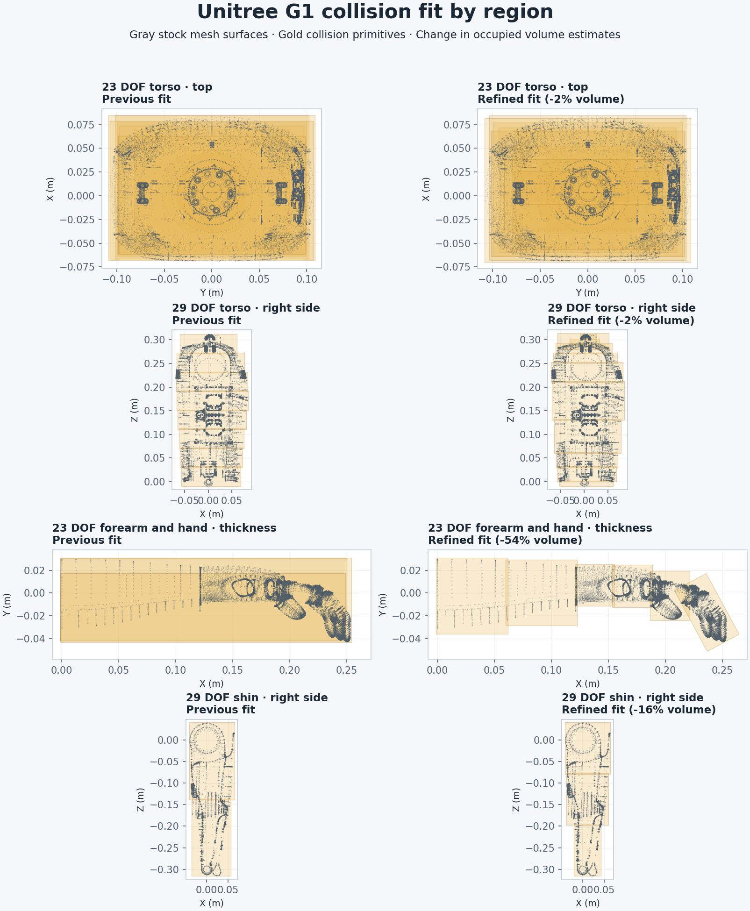
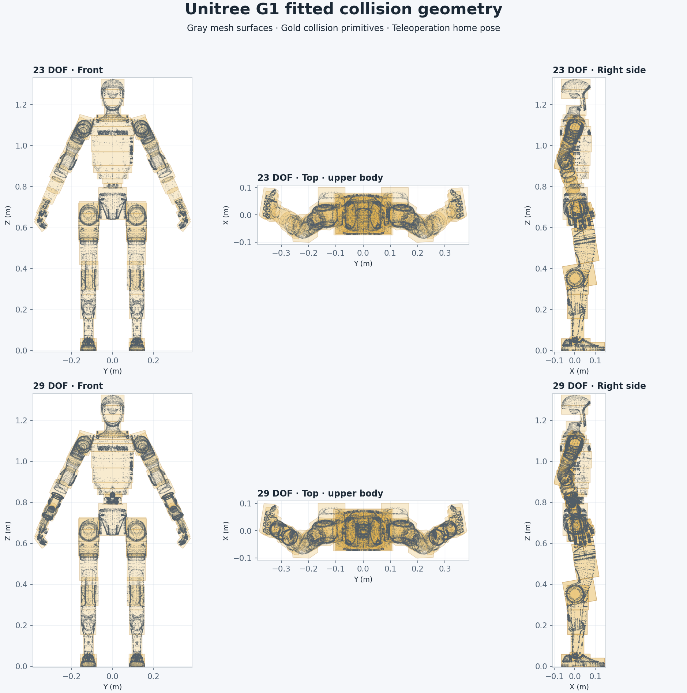

# Unitree G1 standalone MuJoCo teleoperation

The G1 demo uses the same controls and IK backends as the [X2 standalone simulation](agibot_x2.md). It drives the arms of the 23 and 29 DOF revision 1.0 models with stock rubber hands. The pelvis, waist, and legs stay fixed.

## Run the simulation

From the repository root, install the simulation dependencies and start XRoboToolkit PC Service with a headset and two controllers connected.

```bash
python -m pip install -e ".[x2]"
python scripts/simulation/teleop_unitree_g1_mujoco.py --variant 23dof
python scripts/simulation/teleop_unitree_g1_mujoco.py --variant 29dof
```

The defaults are 29 DOF, Placo, fixed-heading tracking, and 50 Hz. The LeRobot backend uses the [same native dependencies as X2](lerobot_ik.md). Waist tracking uses the operator's pelvis and controller poses and requires the [same XR body tracking setup](agibot_x2.md#waist-relative-reference).

```bash
python scripts/simulation/teleop_unitree_g1_mujoco.py --variant 29dof \
  --ik-backend lerobot --tracking-reference waist --visualize-ik
```

Hold either grip to move the corresponding palm in position and orientation. Release to hold the last command. In fixed-heading mode, look forward when engaging the first grip. In waist mode, release both grips before engaging. Hold **Y** to bring both arms home, then release both grips before resuming tracking. The stock hands have no trigger action.

Both backends use joint limits, command slew limits, and sampled self-collision checks with the same defaults as X2. MuJoCo simulates arm dynamics with robot contact forces disabled. To load a custom model, provide both `--xml-path` and `--robot-urdf-path`. Use the named arm joints, unit-gear position servos, `home` keyframe, palm frames, and collision links for the selected variant.

## Palm frames and home pose

The origin of each `left_palm_center` and `right_palm_center` frame is inside the palm, midway through its thickness. The axes rotate with the terminal hand body. These offsets are in stock mesh coordinates, in meters.

| Variant | Left palm XYZ | Right palm XYZ |
| --- | --- | --- |
| 23 DOF | `(0.156, 0.010, -0.003)` | `(0.156, -0.010, -0.003)` |
| 29 DOF | `(0.035, 0.005, -0.003)` | `(0.035, -0.005, -0.003)` |

The 23 DOF variant has five joints per arm and a roll-only wrist. Both backends use the same pose objectives as X2, so a wrist rotation request can cause shoulder or elbow motion and leave position or orientation error. The 29 DOF variant adds wrist pitch and yaw on each arm.

Home uses 0.3 rad shoulder pitch, mirrored ±0.45 rad shoulder roll, 1.0 rad elbow flexion, and zero at the wrists. The wider shoulder roll keeps the checked home pose outside the default 2 cm collision margin for both variants.

## Collision geometry

The IK URDFs enclose the stock visual surfaces with fitted boxes and cylinders. Torso band heights follow changes in the chest profile, and limb fits compare cuts along the longest local mesh axes. Both variants use the same rubber-hand primitives for each side. On the 23 DOF model they are translated by `(0.1215, ±0.0055, 0.0015)` m in the wrist mesh frame, with a separate fit for the forearm. Each foot uses a solid fit to its shell. The fixed chest logo and lower neck collar share the torso collision group, and the upper head retains its own checks.

Estimated primitive-union volumes fell by about 54% for the illustrated 23 DOF forearm and hand, 16% for the illustrated 29 DOF shin, and 2% for each torso. The estimates compare the old and new unions over the same sampling region for each link. The minimum checked clearance at home is about 41 mm for both variants.

Under `assets/unitree/g1/`, the bundled IK URDFs are `g1_23dof_rev_1_0/g1_23dof_rev_1_0_ik.urdf` and `g1_29dof_rev_1_0/g1_29dof_rev_1_0_ik.urdf`. Each has a `collisions.json` beside it and references the shared `../meshes/` directory. The MuJoCo scenes are `g1_23dof_rev_1_0_scene.xml` and `g1_29dof_rev_1_0_scene.xml` in `assets/unitree/g1/`.

For the bundled URDFs, Placo loads the adjacent `collisions.json` before checking the all-zero joint pose. Both IK backends use the selected variant's list at runtime, including when custom model paths are supplied. The all-zero pose has zero intersecting checked pairs, with about 4.6 mm of clearance for 23 DOF and 4.7 mm for 29 DOF. The replay and simulation initialize at the `home` keyframe, which provides clearance above the 20 mm avoidance margin.





After changing model generation, rebuild both asset sets and run the mock-XR replay. Set `X2_TEST_LEROBOT=1` to include the native LeRobot cases.

```bash
python scripts/simulation/build_g1_teleop_assets.py
X2_TEST_LEROBOT=1 python -m unittest discover -s tests -p test_unitree_g1_simulation.py -v
```

## Offline replay

Run a home-to-T-pose replay with real IK and MuJoCo physics using mocked XR input. The G1 target uses ±90° shoulder roll and +90° at both elbows. The replay checks that both simulated upper arms and forearms finish within 10° of pointing straight out to their respective sides. The script prints a JSON report and exits with status 1 if a check fails.

```bash
python scripts/misc/test_ik_offline.py --robot g1 --variant 23dof
python scripts/misc/test_ik_offline.py --robot g1 --variant 29dof --ik-backend lerobot
```

Add `--visualize` for MuJoCo or `--visualize-ik` for the browser IK viewer. The script defaults to X2 when `--robot` is omitted and to 29 DOF when selecting G1 without a variant.
